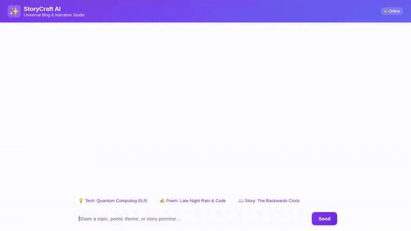
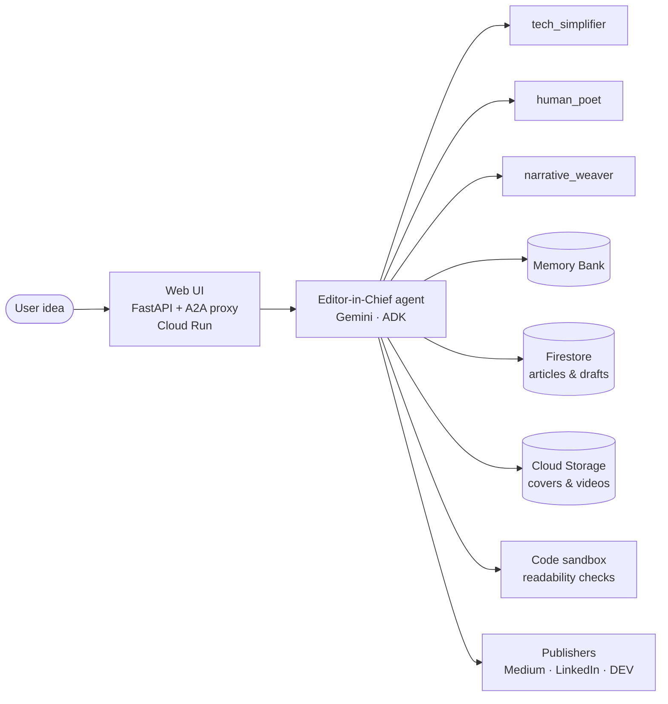

<div align="center">

# ✍️ StoryCraft AI

### A multi-agent writing studio that turns a rough idea into a finished, illustrated post, and publishes it only after you say yes.




</div>

---

## What it does

You give StoryCraft a raw idea ("explain vector databases to my mum", "a poem about monsoon in Hyderabad", "chapter one of a short story"). An **Editor-in-Chief** agent then runs the whole pipeline:

1. **Grills the idea.** Scores it for clarity and hook (1 to 10), proposes three angles, and asks one or two sharp questions about audience and tone. A 7-turn guardrail stops endless back-and-forth.
2. **Routes to a specialist writer.**
   - `tech_simplifier` explains technical topics with ELI5 analogies.
   - `human_poet` writes cadence-aware poetry (with PoetryDB for inspiration).
   - `narrative_weaver` writes fiction, personal essays and story series.
3. **Illustrates it.** Generates a 16:9 editorial cover with Gemini image generation and a short teaser video, and stores both in Cloud Storage.
4. **Checks quality.** Computes Flesch reading ease, read time and poem rhythm in a sandboxed code executor.
5. **Publishes with a human in the loop.** Asks "draft or public?" and only then posts to Medium, LinkedIn or DEV (Instagram and YouTube exports are prepared too). Without API tokens it runs in a safe simulated mode.

It also **remembers you**: preferred tone, audience and publishing style persist across sessions via Vertex AI Memory Bank.

## Architecture



| Layer | Tech |
|---|---|
| Agents | Google ADK, Gemini, three genre subagents |
| Memory | Vertex AI Memory Bank |
| Data | Firestore (`storycraft_articles`) |
| Media | Gemini image generation, Omni video, Cloud Storage |
| UI | A2UI cards (genre badge, read time, cover preview, status) |
| Frontend | FastAPI A2A proxy on Cloud Run |
| Deploy | `agents-cli` to Agent Platform, Terraform in `storycraft-ai/deployment/` |

Full tool specs are in [`storycraft-ai/ARCHITECTURE.md`](storycraft-ai/ARCHITECTURE.md).

## Run it locally

```bash
cd storycraft-ai
cp .env.example .env          # set your GCP project, or a GEMINI_API_KEY
uv sync
uv run agents-cli playground  # local ADK web UI
```

Frontend, deployment and project layout are documented in [`storycraft-ai/README.md`](storycraft-ai/README.md).

## Repository layout

| Path | What's there |
|---|---|
| `storycraft-ai/` | The agent, tools, frontend, tests and deployment config |
| `project_brief.md` | Original product brief and phase-by-phase workflow spec |
| `demo.gif`, `storycraft_agent_demo*.mp4` | Demo recordings |
| `record_demo.py`, `generate_lofi_music.py` | Scripts used to record the demo and its soundtrack |
| `.agents/` | Antigravity skills and MCP config from the workshop starter kit |

## Credits

Built during the **Build with Gemini World Tour (Track 3: agent-first apps)**, starting from Google's workshop starter kit. The starter kit is not an officially supported Google product.

## About me

Built by **Swetha Panthagani**, GenAI engineer. I build multi-agent apps, RAG assistants and LLM automations for businesses. [LinkedIn](https://www.linkedin.com/in/swetha-panthagani/)
