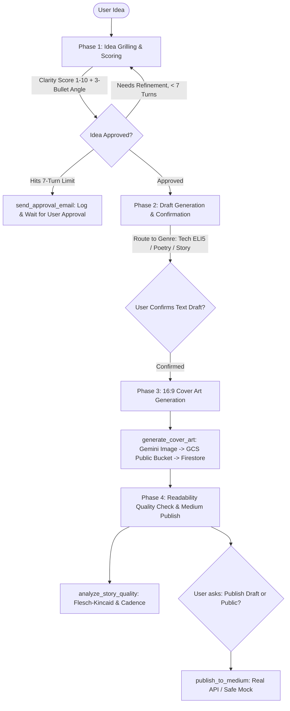

# StoryCraft AI Architecture & Tool Specification

## 1. Overview
StoryCraft AI is a multi-genre content studio agent that takes raw ideas, refines and simplifies them so anyone can understand, generates custom 16:9 editorial cover artwork to Google Cloud Storage, and securely publishes articles to Medium with human-in-the-loop safeguards.

---

## 2. End-to-End Workflow

---

## 3. Tool Specifications

### 3.1 Idea Grilling & Guardrails
- **`analyze_and_score_idea(idea_text, genre)`**:
  - Evaluates idea clarity, potential hook score (1-10), generates 3 alternative angles, and extracts key clarifying questions.
- **`send_approval_email(user_email, subject, proposal_summary)`**:
  - Guardrail tool triggered if refinement reaches 7 iterations. Simulates an email alert and logs the approval payload.

### 3.2 Visuals & Media
- **`generate_cover_art(article_id, visual_prompt)`**:
  - Calls Gemini image generation (`gemini-3.1-flash-lite-image`) for a 16:9 widescreen editorial banner, uploads to public Cloud Storage bucket `storycraft-media-qwiklabs-gcp-03-63146160a304`, and updates the Firestore document with the public image URL.

### 3.3 Quality & Readability
- **`analyze_story_quality(content, genre)`**:
  - Calculates Flesch-Kincaid grade level, estimated reading duration, word count, and poetic rhythm/line structure check.

### 3.4 Publishing
- **`publish_to_medium(article_id, publication_status, confirmed)`**:
  - Requires explicit confirmation (`confirmed=True`).
  - Publishes to Medium REST API if `MEDIUM_INTEGRATION_TOKEN` is present in the environment; otherwise uses simulated publish mode with a valid preview URL.

### 3.5 Persistence (Firestore)
- Hardcoded Project ID: `qwiklabs-gcp-03-63146160a304`
- Collection: `storycraft_articles`
- Functions: `save_article`, `list_articles`, `get_article_by_id`, `update_article_status`.
