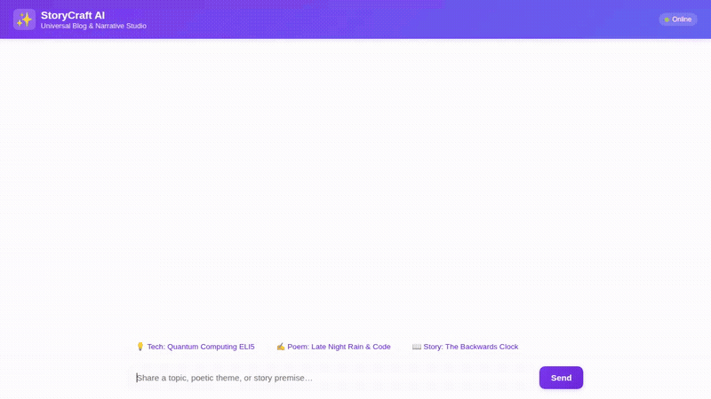

# StoryCraft AI · The Universal Blog & Narrative Studio

StoryCraft AI is an agent-first creative writing and publishing studio built with the Google Agent Development Kit (ADK) and deployed to Google Cloud Agent Platform. It coordinates specialized drafting subagents across technical simplification, lyrical poetry, and narrative fiction, produces editorial media assets, and manages articles and metadata in structured cloud storage.

<div align="center">
  
</div>

---

## 🌟 What StoryCraft AI Does

StoryCraft AI acts as an **Editor-in-Chief** and multi-agent writing room:
- **Phase 1: Idea Grilling & Clarification:** Evaluates raw ideas with an Idea Clarity & Hook Score (1–10), proposes three concrete angles, and asks focused clarifying questions. Includes a 7-iteration guardrail with simulated approval emails.
- **Phase 2: Multi-Genre Routing:** Routes writing to specialized subagents:
  - `tech_simplifier`: High-clarity technical explanations using ELI5 analogies.
  - `human_poet`: Reflective, cadence-aware poetry and verse.
  - `narrative_weaver`: Fiction, personal essays, and narrative arcs.
- **Phase 3: Editorial Cover Generation:** Creates 16:9 widescreen editorial artwork matching the piece, saves the artifact to the agent context, and uploads directly to Google Cloud Storage.
- **Phase 4: Video Synthesis:** Generates short cinematic teaser videos using Google's Omni model (`gemini-omni-flash-preview`) in the global region.
- **Phase 5: Readability & Publishing:** Calculates readability metrics (Flesch Reading Ease and estimated reading times), checks poem rhythm/meter, and prepares drafts for simulated or live Medium / LinkedIn publication.

---

## ☁️ Google Cloud Services & Tools Wired Up

The agent code in `app/` and `agents-cli-manifest.yaml` integrates the following components:

| Component | Technology | Real Implementation in Codebase |
|---|---|---|
| **Core Coordinator Agent** | ADK + `gemini-3.6-flash` | `app/agent.py` root coordinator routing to specialized subagents. |
| **Long-Term Memory** | Vertex AI Memory Bank | Integrated via `PreloadMemoryTool` and durable memory generation callbacks in `app/agent.py`. Remembers user writing preferences, tones, and aesthetic styles across sessions. |
| **Structured Database** | Google Cloud Firestore | `app/firestore_tools.py` storing and managing articles, drafts, and metadata in the `storycraft_articles` collection (`save_article`, `list_articles`, `get_article_by_id`, `update_article_status`). |
| **Asset Storage** | Google Cloud Storage | `app/storycraft_tools.py` streaming generated images and videos directly to public bucket `storycraft-media-qwiklabs-gcp-03-63146160a304`. |
| **Image Generation** | `gemini-3.1-flash-lite-image` | `generate_cover_art` in `app/storycraft_tools.py` generating 16:9 editorial banners and saving artifacts to the ADK `ToolContext`. |
| **Video Generation** | `gemini-omni-flash-preview` | `generate_story_video` in `app/storycraft_tools.py` calling the Interactions API in the `global` region and returning streaming video URLs. |
| **Code Execution Sandbox** | Agent Engine Sandbox | `AgentEngineSandboxCodeExecutor` in `app/agent.py` securely executing code in the cloud for readability metrics and algorithmic checks. |
| **Agent-First UI** | A2UI (v0.8 Basic Catalog) | `app/a2ui_utils.py` and `app/a2ui_prompt.py` generating and rendering Card, Column, Row, Text, and Image UI envelopes. |
| **Web Frontend Proxy** | FastAPI + A2A Protocol | `frontend/main.py` proxying browser chat streams directly to the deployed Agent Platform reasoning engine over the Agent-to-Agent (A2A) protocol. |

*(Note: Live external API dispatch to Medium and LinkedIn uses simulated high-fidelity mode unless corresponding API tokens are provided in `.env`).*

---

## 🛠️ Local Setup & Running Instructions

### 1. Prerequisites
- Python 3.11+
- `uv` package manager (`pip install uv` or `uv tool install google-agents-cli`)
- Google Cloud SDK authenticated with your GCP project:
  ```bash
  gcloud auth login
  gcloud auth application-default login
  gcloud config set project <your-project-id>
  ```

### 2. Install Dependencies
```bash
cd storycraft-ai
uv sync
```

### 3. Run the Agent Playground (Local ADK Web UI)
To test the agent directly in the local ADK developer interface:
```bash
uv run agents-cli playground
```

### 4. Run the Web Chat Frontend Locally
The frontend includes the branded dialogue layout, example prompt chips, and A2UI renderer:
```bash
cd frontend
pip install -r requirements.txt

export AGENT_ENGINE_RESOURCE_NAME="projects/<project-number>/locations/us-east1/reasoningEngines/<engine-id>"
export AGENT_DIRECTORY="app"
export PORT=8080

python main.py
```
Open a browser to access the local server port configured above.

### 5. Deploy to Agent Platform
To deploy or update the agent on Google Cloud Agent Platform:
```bash
agents-cli deploy --project <your-project-id> --no-confirm-project
```

---

## 📂 Project Structure

```
storycraft-ai/
├── app/
│   ├── agent.py               # Root coordinator agent, subagents & tools wiring
│   ├── storycraft_tools.py    # Image gen, Omni video, idea scoring, readability
│   ├── firestore_tools.py     # Firestore article CRUD operations
│   ├── a2ui_prompt.py         # A2UI system prompt & schema definitions
│   ├── a2ui_utils.py          # A2UI callback and parsing handlers
│   └── fast_api_app.py        # Local backend FastAPI server
├── frontend/
│   ├── main.py                # A2A proxy server between web browser and agent
│   ├── Dockerfile             # Container configuration for Cloud Run
│   └── static/
│       └── index.html         # Dialogue UI with prompt chips & A2UI renderer
├── demo.gif                   # Looping recording of the agent in action
├── pyproject.toml             # Python dependencies
└── agents-cli-manifest.yaml   # Agent Platform deployment manifest
```
